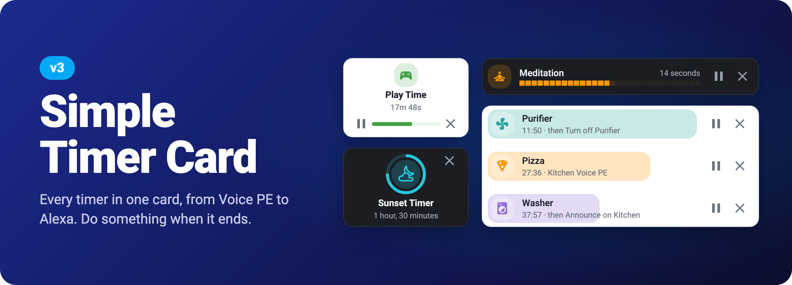
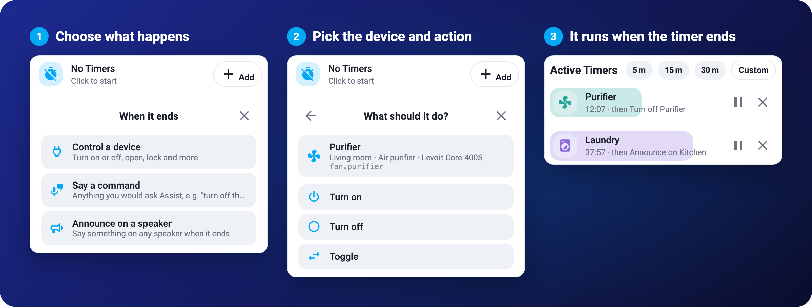

# ⏱️ Simple Timer Card for Home Assistant

[](https://github.com/eyalgal/simple-timer-card/releases)
[](https://github.com/eyalgal/simple-timer-card/releases)
[](https://community.home-assistant.io/t/simple-timer-card-a-clean-way-to-track-timers-in-home-assistant/928813)
[](https://www.buymeacoffee.com/eyalgal)




A **clean timer card for Home Assistant** that shows every timer you have in
one place: native `timer.*` entities, voice satellites, Alexa, Google Home,
helpers, MQTT, or timers the card creates itself.

**Simple by default, powerful when you need it.**

---

## 🆕 New in v3

* **Do something when a timer ends.** Turn off the air purifier, say a
  command, or announce "Laundry is done" on any speaker. Home Assistant runs it,
  even with every dashboard closed. Needs the optional
  [companion integration](https://github.com/eyalgal/simple-timer-card-integration).

  

* **Every voice timer, automatically.** Voice PE and other ESPHome, Wyoming and
  VoIP satellites get Home Assistant timer lists, and the card finds them on its
  own: start, pause, extend and cancel them, or start a timer on a specific
  speaker. No custom firmware, no template sensors.
  *Coming soon:* the card is ready, and Home Assistant is adding timer lists to
  voice satellites ([follow the progress](https://github.com/home-assistant/core/pulls?q=is%3Apr+label%3A%22integration%3A+timer_list%22+%22Add+timer+lists+to%22+in%3Atitle)).
  Voice PE and other ESPHome satellites are expected in Home Assistant 2026.12;
  Wyoming, VoIP and phones are still in review. Until then, Alexa, Google Home
  and the [legacy Voice PE setup](CONFIGURATION.md#-voice-pe-integration) keep
  working.

---

## 🚀 Highlights

* **Every timer in one card**: native timers, voice satellites, Alexa, Google
  Home, helpers, MQTT, timestamps and the card's own timers
* **Actions when timers end**: devices, commands and announcements, with the
  [companion integration](https://github.com/eyalgal/simple-timer-card-integration)
* **Auto-discovery**: voice, Alexa and Google Home timers without listing
  every device
* **Styles**: bars, fills and circles, with drain, fill or milestone progress
* **Simple editor**: the essentials up front, everything else under
  **Advanced**
* **Theme aware and multilingual**: English, German, Spanish, Danish, Italian,
  French, Hebrew (RTL), Polish, Dutch and Swedish

---

## 📦 Installation

### Marketplace (fka HACS) (recommended)

Simple Timer Card is available in **Marketplace (fka HACS)**.

[](https://my.home-assistant.io/redirect/hacs_repository/?owner=eyalgal&repository=simple-timer-card)

For actions when timers end, also install the
[companion integration](https://github.com/eyalgal/simple-timer-card-integration).

### Manual

1. Download `simple-timer-card.js` from the latest release
2. Copy it to `config/www`
3. Add it to Lovelace resources:

```yaml
resources:
  - url: /local/simple-timer-card.js
    type: module
```

---

## 🚦 Quick start

Just add it. Timers you start are kept in this browser, or in Home Assistant
when the [companion integration](https://github.com/eyalgal/simple-timer-card-integration)
is installed:

```yaml
type: custom:simple-timer-card
```

See every timer in your home:

```yaml
type: custom:simple-timer-card
auto_discover_timer_lists: true
auto_discover_alexa: true
auto_discover_google: true
```

> Alexa and Google Home timers can be snoozed and dismissed on the card, but
> not started or paused from it. Dismissing a Google Home timer also stops the
> speaker.

Want timers that do something when they end, and keep running with every
dashboard closed? Install the [companion integration](https://github.com/eyalgal/simple-timer-card-integration).
New cards then use it automatically; for an existing card, set:

```yaml
type: custom:simple-timer-card
storage: integration
```

Everything else, including styles, presets, pinned timers, sounds,
notifications and tap actions, is in the editor's **Advanced** mode and in
[`CONFIGURATION.md`](CONFIGURATION.md).

**Guides:** [Voice timers](CONFIGURATION.md#-voice-timers-timer-lists) ·
[Companion integration](CONFIGURATION.md#-companion-integration) ·
[Moving from MQTT](CONFIGURATION.md#-moving-from-mqtt-to-the-integration) ·
[MQTT storage](mqtt-hybrid-model.md) · Legacy:
[Voice PE](voice-pe/voice-pe.md) and
[Voice PE with ESPHome](voice-pe/voice-pe-esphome.md)

---

## ⬆️ Updating to v3

Nothing breaks: every v2 option means the same, and browser and MQTT storage
work as before. To use the new features:

* **Actions when timers end:** install the
  [companion integration](https://github.com/eyalgal/simple-timer-card-integration) and set **Save new timers in** to it in the
  editor. Coming from MQTT? The editor can
  [move your running timers](CONFIGURATION.md#-moving-from-mqtt-to-the-integration).
* **Voice timers** ([coming soon](https://github.com/home-assistant/core/pulls?q=is%3Apr+label%3A%22integration%3A+timer_list%22+%22Add+timer+lists+to%22+in%3Atitle)): once your
  speaker has a *Timers* entity on its device page, turn on
  **Auto-discover voice timers**. The custom-firmware Voice PE setup
  (`mode: voice_pe`, `auto_voice_pe`) then becomes legacy; see the
  [migration steps](CONFIGURATION.md#moving-from-the-legacy-voice-pe-setup).

Everything else in v3 is in the
[release notes](https://github.com/eyalgal/simple-timer-card/releases).

---

## 🔒 Security

Input validation and sanitization, safe audio URL handling, rate limiting for actions, and graceful handling of corrupted storage. See [`SECURITY.md`](SECURITY.md) for details.

---

## ❤️ Support

If you enjoy this card and want to support its development:

<a href="https://coff.ee/eyalgal" target="_blank">
  
</a>
